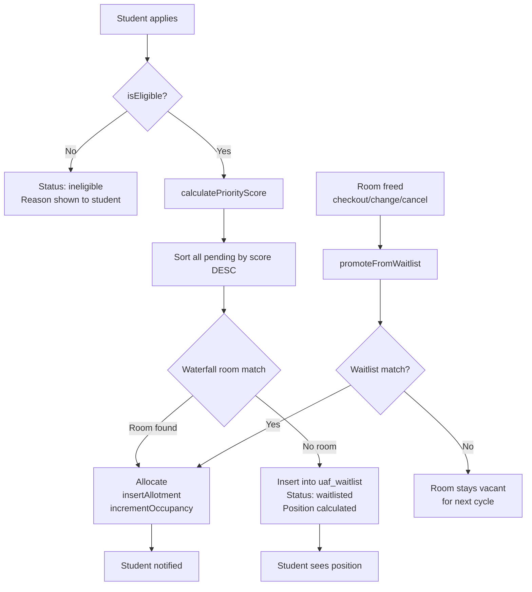

# Allocation Architecture (UAF Hostel)

## 1) Four-phase allocation flow

1. **Score** every eligible applicant
2. **Waterfall match** room types (International/PhD -> General fallback)
3. **Waitlist** unmatched eligible applicants with ranked positions
4. **KNN recommendation layer** for admin guidance only

## 2) Eligibility rules

These students are marked `ineligible` and are never allocated or waitlisted:

- `has_unpaid_dues = 1`
- `is_uaf_student = 0`

## 3) Table ownership

### Official allocator (source of truth)
- `uaf_hostel_rooms`
- `student_applications`
- `uaf_allotments`
- `uaf_waitlist`
- `uaf_room_events`

### Recommendation subsystem (assistive)
- `rooms`
- `hostels`
- `allocations`
- `students`

## 4) Priority score formula (System 1)

Base by degree:
- PhD: `+500`
- MS/MPhil: `+300`
- UG Year 4: `+200`
- UG Year 3: `+150`
- UG Year 2: `+100`
- UG Year 1: `+50`

Academic:
- `+ (cgpa * 10)` (CGPA clamped to 4.0)

Special boosts:
- `has_disability = 1` -> `+200`
- `is_international = 1` -> `+150`
- `distance_from_home > 100` -> `+50`

Penalty:
- `past_violations_count * 25` subtracted

Floor:
- `max(score, -1000)`

## 5) Waitlist promotion trigger

`promoteFromWaitlist()` is called whenever beds are freed by:
- checkout
- room change
- cancellation
- manual free action

It promotes by highest priority first, then oldest waitlist time.

## 6) End-to-end flowchart

